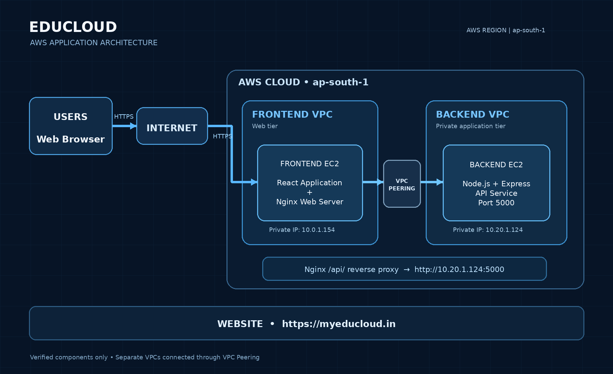

# AWS Architecture

## 1. Architecture Overview

EduCloud uses two separate AWS EC2 environments for hosting its frontend and backend applications.

## 2. High-Level Architecture

```text
Internet
   |
   v
myeducloud.in
   |
   v
Frontend EC2 (React + Nginx)
   |
   v
Nginx Reverse Proxy
   |
   v
VPC Peering
   |
   v
Backend EC2 (Node.js + Express)
   |
   v
Database
```

## 3. Frontend Environment

- Technology: React.js
- Web Server: Nginx
- Reported Private IP: 10.0.1.154

## 4. Backend Environment

- Technology: Node.js and Express
- Application Port: 5000
- Reported Private IP: 10.20.1.124

## 5. Request Flow

1. User opens the EduCloud website.
2. Nginx serves the React frontend.
3. Frontend sends API requests to the same domain.
4. Nginx forwards API requests to the backend.
5. Backend processes requests and returns responses.

## 6. Network Communication

Frontend and backend communicate through private IP addressing using VPC Peering.

Connectivity was verified with a successful HTTP 200 response from the backend.

## 7. Project Website

https://myeducloud.in

## 8. AWS Architecture Diagram

The diagram below provides a visual overview of the EduCloud AWS infrastructure.


