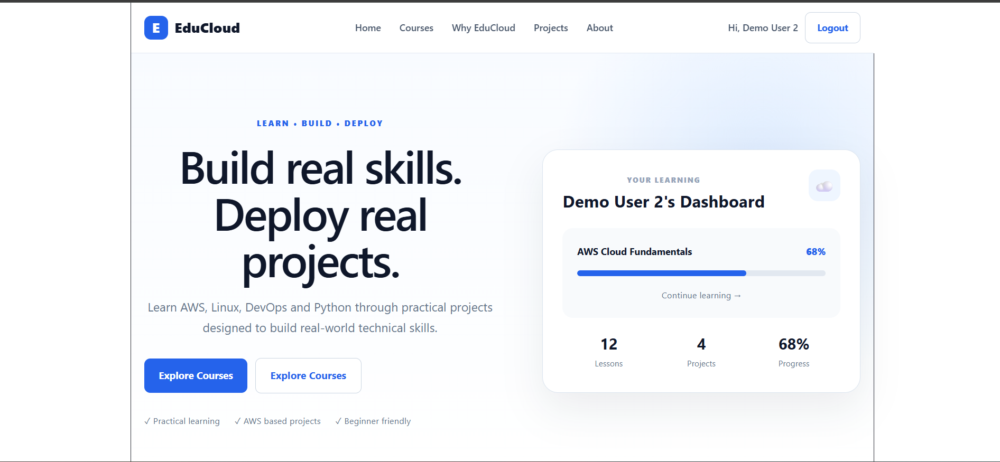
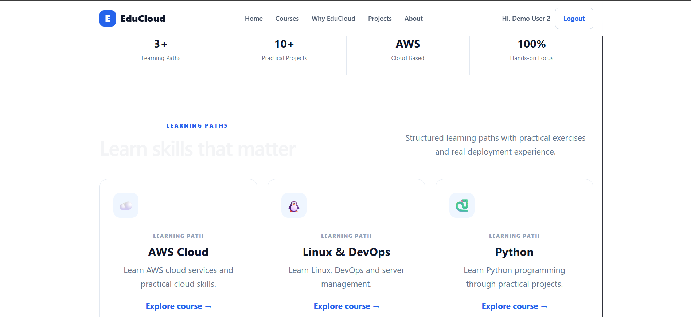
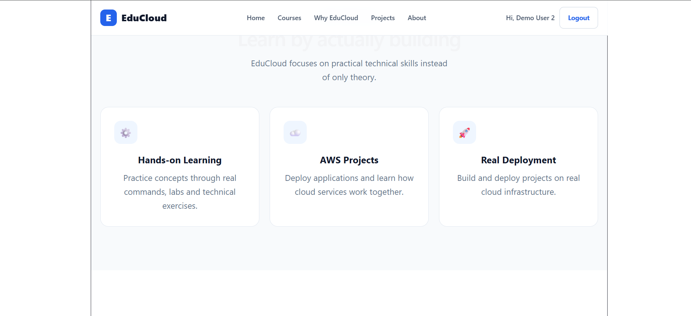
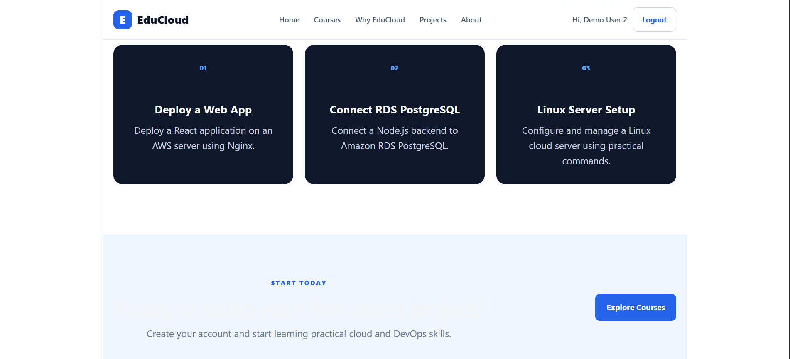
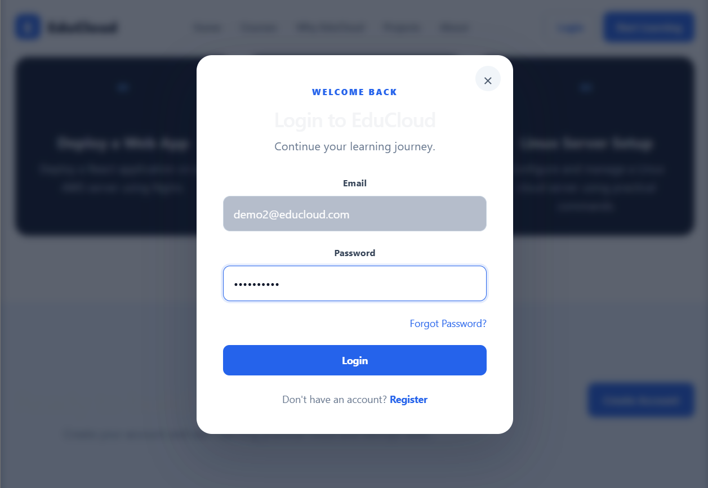
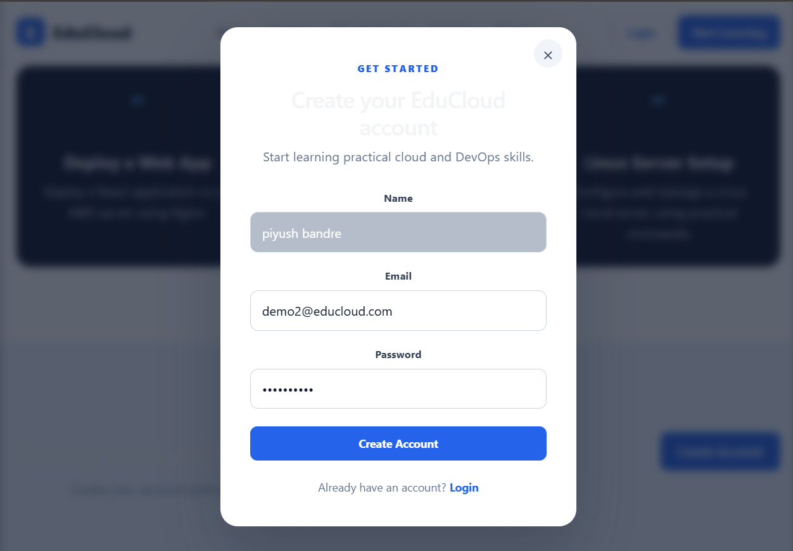
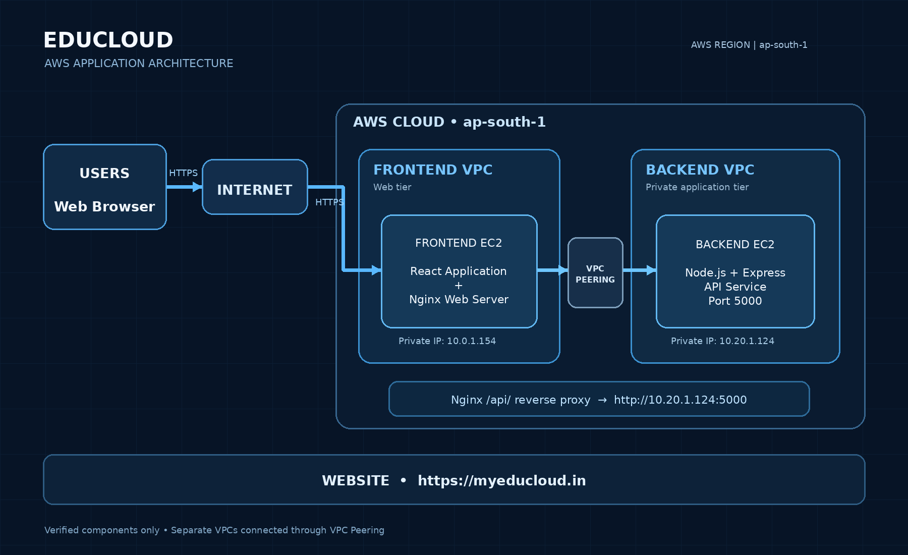

# ☁️ EduCloud Documentation

  <b>Learn • Build • Deploy</b> 
  AWS-Based Cloud Learning Platform

---

## 📖 About EduCloud

EduCloud is a cloud-based learning platform designed to help learners develop practical skills in AWS, Linux, DevOps, and Python.

This documentation covers the project architecture, infrastructure, application components, deployment, testing, and troubleshooting.

## 📚 Documentation Index

| # | Documentation | Description |
|---|---|---|
| 01 | [Project Overview](01-project-overview.md) | Introduction, objectives and features |
| 02 | [AWS Architecture](02-aws-architecture.md) | Architecture and application flow |
| 03 | [AWS Infrastructure](03-aws-infrastructure.md) | EC2 and infrastructure details |
| 04 | [Networking & Security](04-networking-security.md) | VPC Peering and network communication |
| 05 | [Frontend & Backend](05-frontend-backend.md) | Application technologies and setup |
| 06 | [API Documentation](06-api-documentation.md) | Backend REST API endpoints |
| 07 | [Docker Implementation](07-docker-implementation.md) | Containerization details |
| 08 | [Testing & Validation](08-testing-validation.md) | Verified application test results |
| 09 | [Troubleshooting](09-troubleshooting.md) | Issues and resolutions |
| 10 | [Cost Optimization](10-cost-optimization.md) | AWS cost management practices |
| 11 | [Future Improvements](11-future-improvements.md) | Planned enhancements |

## 🛠️ Technology Stack

- React.js
- Node.js
- Express.js
- Nginx
- Amazon EC2
- AWS VPC Peering
- Docker
- JWT Authentication

## 🌐 Project Website

[https://myeducloud.in](https://myeducloud.in)

## 📁 Assets

- `assets/architecture/` — Architecture diagrams
- `assets/screenshots/` — Application screenshots

---

  <b>EduCloud — Learn. Build. Deploy.</b>

## 🖼️ Application Screenshots

### Homepage

### Learning Paths

### Why EduCloud

### Projects

### Login

### Registration

## AWS Architecture

The following diagram illustrates the EduCloud AWS infrastructure, including the Frontend EC2, Backend EC2, and VPC Peering connection.

